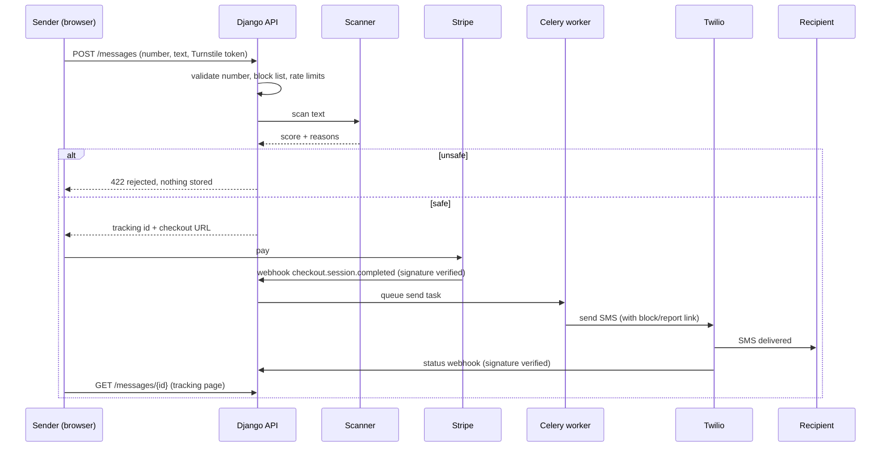

# Texhaven

**Send a text from any browser. Scams never reach the other side.**

Texhaven lets anyone send a real SMS from a web page: no app to install and no account to create.
Every message is scanned for phishing, scams, threats and abuse *before* it is sent, and every recipient
gets a one-tap way to block the number or report abuse.

> Status: complete working MVP. Runs fully offline in **demo mode** (simulated SMS and payment).
> Real sending needs your own Twilio and Stripe accounts (see [Go live](#go-live)).

---

## Table of contents

1. [Features](#features)
2. [How it works](#how-it-works)
3. [Tech stack](#tech-stack)
4. [Project structure](#project-structure)
5. [Quick start](#quick-start)
6. [Configuration](#configuration)
7. [API reference](#api-reference)
8. [Security design](#security-design)
9. [Testing](#testing)
10. [Go live](#go-live)
11. [Useful commands](#useful-commands)
12. [Troubleshooting](#troubleshooting)
13. [Roadmap](#roadmap)

---

## Features

**For senders**

- Browser SMS to mobile numbers worldwide, with a country picker and live number validation
- Live phone preview, character counter and segment/price calculator (GSM-7 and Unicode aware)
- Pay once by card (Stripe Checkout), no sign-up
- Private tracking link: Created, Paid, Sent, Delivered
- Automatic refund when delivery fails

**Safety and abuse protection**

- Scam and abuse scanner with four layers: text rules, URL analysis, Google Safe Browsing, optional AI second opinion
- Threats and harassment are always blocked
- Payment before sending, per-number and per-IP daily limits, Cloudflare Turnstile bot check
- Every SMS ends with a link where the recipient can **block the number** or **report abuse**; replying `STOP` also blocks
- Blocked numbers can never be texted again; pending messages to them are cancelled and refunded

**Privacy**

- Phone numbers and message text are encrypted at rest and wiped after 48 hours
- Lookups use keyed hashes, so the raw number is never needed for rate limits or the block list
- Logs never contain phone numbers, message text or raw IP addresses

**Free tool**

- **Scam checker**: paste any suspicious text and get a risk score, reasons, link analysis and advice (nothing is stored)

---

## How it works



After 48 hours a scheduled job wipes the encrypted number and text.

---

## Tech stack

| Area         | Technology                                                                                                           |
| ------------ | -------------------------------------------------------------------------------------------------------------------- |
| Frontend     | React 18, TypeScript, Vite, React Router, Tailwind CSS 3, `libphonenumber-js`, Cloudflare Turnstile widget         |
| Backend      | Django 5.2, Django REST Framework, `drf-spectacular` (OpenAPI docs), `django-cors-headers`, WhiteNoise, Gunicorn |
| Jobs         | Celery (worker and beat) with Redis                                                                                  |
| Data         | SQLite for local dev, PostgreSQL for production                                                                      |
| Security     | `cryptography` (Fernet encryption with key rotation), HMAC-SHA256 hashing, Turnstile, DRF throttling               |
| Integrations | Twilio (SMS), Stripe Checkout (payments and refunds), Google Safe Browsing (optional), Claude API (optional)         |
| Tooling      | Vitest, Django test runner (42 backend tests), Docker and docker-compose, GitHub Actions CI                          |

---

## Project structure

```
texhaven/
├── backend/
│   ├── config/                 settings, urls, celery app
│   └── apps/
│       ├── core/               crypto, rate limiting, Turnstile, IP handling, config/health endpoints
│       ├── scanner/            rules, URL checks, Safe Browsing, AI layer, scoring engine, /scan API
│       └── messaging/          models, services, Twilio/Stripe integration, tasks, views, admin
├── frontend/
│   └── src/
│       ├── pages/              Landing, Send, Track, Checker, Recipient, MockPay, Legal
│       ├── components/         Layout, PhoneField, PhoneBubble, TurnstileBox, Logo
│       └── lib/                API client, SMS length math, country list, config context
├── docs/THREAT_MODEL.md        threats and mitigations
├── docker-compose.yml          Postgres, Redis, API, worker, beat, frontend
└── .github/workflows/ci.yml    tests, build, dependency audits
```

---

## Quick start

Demo mode needs **no accounts or API keys**: SMS is logged to the console and payment is a simulated page.

### Prerequisites

- Python 3.11+ (tested on 3.12)
- Node.js 20+ (tested on 22)

### 1. Backend

```bash
cd backend
python -m venv .venv
source .venv/bin/activate          # Windows: .venv\Scripts\activate
pip install -r requirements.txt
cp .env.example .env               # Windows: copy .env.example .env
python manage.py migrate
python manage.py runserver
```

API: http://localhost:8000 &nbsp;|&nbsp; Interactive docs: http://localhost:8000/api/docs/

### 2. Frontend (new terminal)

```bash
cd frontend
npm install
npm run dev
```

App: http://localhost:5173 (the dev server proxies `/api` to the backend)

### 3. Try it

1. Open http://localhost:5173/send, enter any valid mobile number and a message
2. Click **Check and pay**, then **Simulate payment** on the demo checkout page
3. Watch the tracking page reach **Delivered** (the backend console shows the "sent" log line)
4. Try a scam text such as *"Your bank account is suspended. Verify KYC now at http://hdfc-secure.xyz"*: it is rejected
5. Open http://localhost:5173/checker to use the free scam checker

### Run everything with Docker (Postgres, Redis, worker, beat)

```bash
cp backend/.env.example backend/.env
docker compose up --build
```

Open http://localhost:8080.

---

## Configuration

All settings come from environment variables. Copy `backend/.env.example` to `backend/.env`.

### Core

| Variable                 | Default                   | Purpose                                                                                     |
| ------------------------ | ------------------------- | ------------------------------------------------------------------------------------------- |
| `DEBUG`                | `False`                 | Set `True` for local development only                                                     |
| `SECRET_KEY`           | none                      | Django secret (required when `DEBUG=False`)                                               |
| `DATA_ENCRYPTION_KEYS` | none                      | Comma-separated Fernet keys; first encrypts, all decrypt (rotation). Required in production |
| `HASH_PEPPER`          | none                      | Secret for hashing numbers and IPs. Required in production                                  |
| `ALLOWED_HOSTS`        | `localhost,127.0.0.1`   | Hostnames the API serves                                                                    |
| `FRONTEND_URL`         | `http://localhost:5173` | Used in SMS links, CORS and Stripe redirects                                                |
| `PUBLIC_API_URL`       | `http://localhost:8000` | Public API origin (used to verify Twilio signatures)                                        |
| `CORS_ALLOWED_ORIGINS` | `FRONTEND_URL`          | Comma-separated allowed origins                                                             |
| `ADMIN_URL`            | `admin`                 | Change it in production                                                                     |
| `DATABASE_URL`         | empty (SQLite)            | Postgres URL in production                                                                  |
| `REDIS_URL`            | empty                     | Cache and Celery broker in production                                                       |
| `CELERY_EAGER`         | `DEBUG`                 | Run tasks inline (no worker needed locally)                                                 |
| `NUM_PROXIES`          | `0`                     | How many reverse proxies sit in front of Django                                             |

Generate the secrets with `python manage.py gen_keys`.

### Sending and payments

| Variable                                                   | Default       | Purpose                                                    |
| ---------------------------------------------------------- | ------------- | ---------------------------------------------------------- |
| `SMS_ENABLED`                                            | `True`      | `False` turns sending off and shows the waitlist instead |
| `SMS_PROVIDER`                                           | `console`   | `console` (demo) or `twilio`                           |
| `PAYMENT_PROVIDER`                                       | `mock`      | `mock` (demo) or `stripe`                              |
| `TWILIO_ACCOUNT_SID`, `TWILIO_AUTH_TOKEN`              | none          | Twilio credentials                                         |
| `TWILIO_MESSAGING_SERVICE_SID` or `TWILIO_FROM_NUMBER` | none          | Sender identity                                            |
| `STRIPE_SECRET_KEY`, `STRIPE_WEBHOOK_SECRET`           | none          | Stripe credentials                                         |
| `PRICE_PER_SEGMENT_CENTS`                                | `149`       | Price per 160-character segment                            |
| `CURRENCY`                                               | `usd`       | Stripe currency                                            |
| `MAX_SEGMENTS`                                           | `4`         | Longest message allowed                                    |
| `MESSAGE_TTL_HOURS`                                      | `48`        | When number and text are wiped                             |
| `DAILY_LIMIT_PER_RECIPIENT` / `DAILY_LIMIT_PER_IP`     | `2` / `5` | Abuse limits                                               |
| `BLOCKED_COUNTRIES`                                      | empty         | ISO codes you do not want to send to, e.g. `RU,KP`       |
| `REFUND_ON_FAILURE`                                      | `True`      | Auto-refund undelivered messages                           |

### Bot protection and scanner

| Variable                                         | Purpose                                                                   |
| ------------------------------------------------ | ------------------------------------------------------------------------- |
| `TURNSTILE_SITE_KEY`, `TURNSTILE_SECRET_KEY` | Cloudflare Turnstile. The example file uses Cloudflare's public test keys |
| `BLOCK_THRESHOLD`                              | Score (0-100) at which a message is refused. Default `60`               |
| `ANTHROPIC_API_KEY`, `ANTHROPIC_MODEL`       | Optional AI second opinion for borderline messages                        |
| `GOOGLE_SAFE_BROWSING_API_KEY`                 | Optional known-bad-link lookup                                            |

Frontend: `VITE_API_URL` (empty in local dev; in production the full API URL, e.g. `https://api.yourdomain.com/api/v1`).

**Safety rail:** with `DEBUG=False` the app refuses to start if keys are missing or if the demo providers (`console`, `mock`) are still selected.

---

## API reference

Base path: `/api/v1`. Full interactive docs at `/api/docs/` when `ENABLE_API_DOCS=True` (default in debug).

| Method | Path                               | Purpose                                                           |
| ------ | ---------------------------------- | ----------------------------------------------------------------- |
| GET    | `/health/`                       | Liveness and database check                                       |
| GET    | `/config/`                       | Public settings for the frontend (price, limits, footer template) |
| POST   | `/waitlist/`                     | Join the waitlist                                                 |
| POST   | `/scan/`                         | Free scam checker. Body: `text`, `turnstile_token`            |
| POST   | `/messages/`                     | Create a message and get a checkout URL                           |
| GET    | `/messages/{track_id}/`          | Delivery status (never returns text or the full number)           |
| POST   | `/messages/{track_id}/mock-pay/` | Demo payment (only when `PAYMENT_PROVIDER=mock`)                |
| GET    | `/recipient/{token}/`            | Recipient page info (masked number, blocked or not)               |
| POST   | `/recipient/{token}/block/`      | Block a number                                                    |
| POST   | `/recipient/{token}/report/`     | Report abuse (also blocks)                                        |
| POST   | `/webhooks/stripe/`              | Stripe payment events (signature verified)                        |
| POST   | `/webhooks/twilio/status/`       | Delivery receipts (signature verified)                            |
| POST   | `/webhooks/twilio/inbound/`      | Incoming replies, `STOP` blocks the number                      |

Example:

```bash
curl -X POST http://localhost:8000/api/v1/scan/ \
  -H "Content-Type: application/json" \
  -d '{"text":"Your parcel is held, pay customs fee at http://dhl-track.top/x"}'
```

---

## Security design

| Concern          | What Texhaven does                                                                                              |
| ---------------- | --------------------------------------------------------------------------------------------------------------- |
| Data at rest     | Number and text encrypted with Fernet; wiped after 48 hours                                                     |
| Lookups          | Keyed HMAC-SHA256 hashes for the block list and rate limits                                                     |
| Bots and spam    | Turnstile (fails closed), scoped DRF throttles, per-number and per-IP daily caps, payment before send           |
| Forged callbacks | Stripe signature and timestamp verified; Twilio signature verified; state changes are idempotent and row-locked |
| IP spoofing      | Only trusts exactly `NUM_PROXIES` proxy hops                                                                  |
| Enumeration      | Generic error messages, identical response for duplicate waitlist emails, 24-character random tokens            |
| Token separation | Sender gets a tracking id; recipient gets a different block/report token                                        |
| Admin            | Encrypted fields hidden; decrypting is only possible with an audited command                                    |
| Headers          | Strict CSP and no-store on API responses, HSTS and secure cookies in production                                 |
| Supply chain     | CI runs `pip-audit` and `npm audit`                                                                         |

See [`docs/THREAT_MODEL.md`](docs/THREAT_MODEL.md) for the full table and known limits.

---

## Testing

```bash
# backend (42 tests: scanner, encryption, rate limits, payment and webhook flow, blocklist, purge)
cd backend
DEBUG=True python manage.py test apps          # Windows PowerShell: $env:DEBUG="True"; python manage.py test apps

# frontend (SMS length math must match the backend) and production build
cd frontend
npm test
npm run build
```

---

## Go live

1. **Secrets:** `python manage.py gen_keys`, store `SECRET_KEY`, `DATA_ENCRYPTION_KEYS`, `HASH_PEPPER` in your host's secret manager.
2. **Production mode:** `DEBUG=False`, `SMS_PROVIDER=twilio`, `PAYMENT_PROVIDER=stripe`.
3. **Infrastructure:** Postgres (`DATABASE_URL`), Redis (`REDIS_URL`), real Turnstile keys, correct `ALLOWED_HOSTS`, `FRONTEND_URL`, `PUBLIC_API_URL`, `CORS_ALLOWED_ORIGINS`, `NUM_PROXIES`.
4. **Processes:** run the web app (`gunicorn config.wsgi`), a Celery worker (`celery -A config worker`) and Celery beat (`celery -A config beat`).
5. **Stripe:** add a webhook to `https://<api>/api/v1/webhooks/stripe/` for `checkout.session.completed`.
6. **Twilio:** set the inbound webhook to `https://<api>/api/v1/webhooks/twilio/inbound/` (the status callback is set automatically). Complete sender registration for your target countries (for example A2P 10DLC in the US) and read Twilio's acceptable-use policy.
7. **Frontend:** build with `VITE_API_URL` set, host on Cloudflare Pages or Vercel, and edit `frontend/public/_headers` to replace `YOUR-API-DOMAIN`.
8. **Legal:** have the Legal page and terms reviewed before public launch.

**Free-tier warning:** free backend plans (Render, Railway trial, etc.) sleep when idle, so the first request can take 30 to 50 seconds.
Use a small paid plan or a keep-alive before a public launch. Vercel's Hobby plan is non-commercial, so prefer Cloudflare Pages or Netlify for a paid product.

**Launching on BetaList:** set `SMS_ENABLED=False` first. The landing page then shows a waitlist while the free Scam Checker stays fully usable,
which is a safe live demo while your Twilio registration is pending.

---

## Useful commands

```bash
python manage.py gen_keys                                        # generate production secrets
python manage.py createsuperuser                                 # admin at /<ADMIN_URL>/
python manage.py reveal_message <track_id> --reason "case 123"   # decrypt one message for a legal request (audited)
python manage.py shell -c "from apps.messaging.tasks import purge_expired; print(purge_expired())"   # run cleanup now
```

---

## Troubleshooting

| Problem                                                  | Fix                                                                                                                                                     |
| -------------------------------------------------------- | ------------------------------------------------------------------------------------------------------------------------------------------------------- |
| Buttons stay disabled on Send or Checker                 | The Turnstile widget could not load (offline or blocked). For local dev set `TURNSTILE_SITE_KEY=` (empty) in `backend/.env` and restart the backend |
| `ImproperlyConfigured: ... required when DEBUG is off` | You are in production mode without keys. Run `gen_keys`, or set `DEBUG=True` locally                                                                |
| `429 Too many requests`                                | Limits are working. Local numbers: 2 messages per number per day. Clear by restarting the backend (in-memory cache)                                     |
| Frontend shows "Cannot reach the server"                 | Backend is not running on port 8000, or `VITE_API_URL` is wrong                                                                                       |
| Stripe webhook returns 400                               | Wrong `STRIPE_WEBHOOK_SECRET`, or the request body was modified by a proxy                                                                            |
| Twilio webhook returns 403                               | `PUBLIC_API_URL` must exactly match the public URL Twilio calls (scheme and host)                                                                     |
| Rate limits seem shared by all users in production       | Set `NUM_PROXIES` to the number of proxies in front of Django                                                                                         |

---

## Roadmap

- Scheduled and group SMS
- Chrome extension for scam detection
- Receiver-side scam checker API for businesses
- More payment methods and local pricing
- Admin dashboard for reviewing abuse reports

---

## Disclaimer

The scanner is heuristic and can miss new scams or flag harmless messages. Telecom and privacy rules (A2P 10DLC, TCPA, GDPR, local regulations)
vary by country and are your responsibility before launching publicly. This README is not legal advice.
